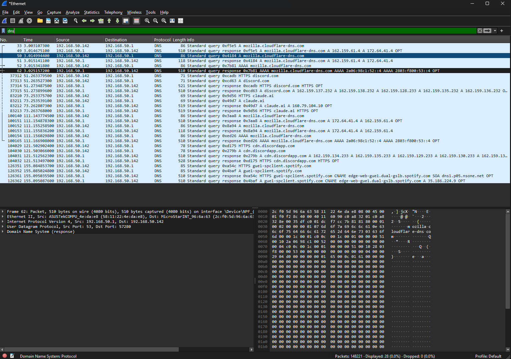
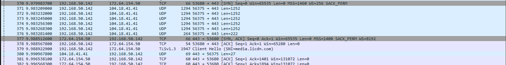

# Lab 1: Normal traffic

## Goal
learn what normal traffic looks like, so I can spot bad traffic later.

---

## What I Did
I started a Wireshark capture on Computer A ('JayPC' , 192.168.40.142), browsed 2-3 websites for about 60 seconds, then stopped the capture.

---
 
## 1. Only My Computer's Traffic
```
ip.addr == 192.168.50.142
```
This shows only Computer A's traffic.

---
 
## 2. DNS Lookups
```
dns
```
DNS (Domain Name System) is how my computer asks for a website's IP address.
 
<!-- TODO: name 2–3 websites you saw in the DNS lookups -->
I saw lookups for: Discord.com, Claude.ai, Spotify.com, mozilla.cloudflare-dns.com as im using Firefox as a browser
 


## 3. TCP Handshake
```
tcp.flags.syn == 1
```
This filter allows me to see the SYN or SYN-ACK packets that were sent.
but I can't see ACK packets since the SYN flag is turned off.

Every TCP (Transmission Control Protocol) connection starts with 3 packets:
 
1. **SYN** – my computer: "I want to connect"
2. **SYN/ACK** – the server: "OK, ready"
3. **ACK** – my computer: "Connected"
   
I found all 3 between my computer (192.168.50.142:53680) and a server (172.64.154.50) on port 443 (HTTPS):
 
| Packet | From → To | What it is |
|---|---|---|
| 370 | 192.168.50.142 → 172.64.154.50 | **SYN** |
| 377 | 172.64.154.50 → 192.168.50.142 | **SYN/ACK** (about 9 ms later) |
| 378 | 192.168.50.142 → 172.64.154.50 | **ACK** – connection is open |
| 379 | 192.168.50.142 → 172.64.154.50 | **Client Hello** for `media.licdn.com` – the HTTPS part starts |


