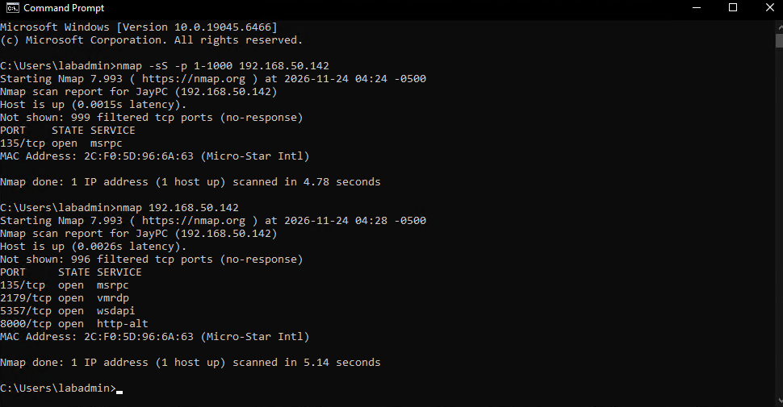

# Lab 2: Port Scan
 
## Goal
Learn how to catch someone checking my computer's Ports
 
**MITRE ATT&CK:** T1046 – Network Service Discovery
 
---

## My Setup
 
| Role | IP |
|---|---|
| Computer A (Wireshark, the target) | 192.168.50.142 |
| Computer B (Nmap, the "attacker") | 192.168.50.216 |

---

## What I Did
I started a Wireshark capture on Computer A. Then on Computer B, I opened Command Prompt as administrator and ran an Nmap scan against Computer A. After the scan finished, I stopped the capture.

---
 
## 1. The Nmap Scan
```
nmap 192.168.50.142
```
This checks the 1,000 most common ports on Computer A. Because I ran it as administrator, Nmap uses a **SYN scan**: it sends a SYN to each port but never finishes the handshake.
 
<!-- TODO: list what Nmap found -->
Nmap found these open ports: 135, 2179, 5357 and 8000
 


