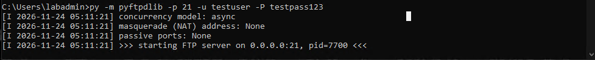
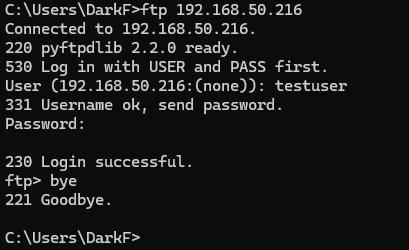

# Lab 3: Stolen Passwords
 
## Goal
Catch a fake password traveling across the network in plain text.
 
**MITRE ATT&CK:** T1040 – Network Sniffing

 ---

## My Setup
 
| Role | IP |
|---|---|
| Computer A (Wireshark, FTP client) | 192.168.50.142 |
| Computer B (FTP server) | 192.168.50.216 |
 
**Fake login used:** `testuser` / `testpass123` (used for this lab)

---

## What I Did
I set up a small FTP (File Transfer Protocol) server on Computer B. Then I started a Wireshark capture on Computer A, logged in to the FTP server, and looked for the password in the capture.

---

## 1. Start the FTP Server (Computer B)
```
py -m pip install pyftpdlib
py -m pyftpdlib -p 21 -u testuser -P testpass123
```
Using python

The first command installs a small FTP server. The second one turns it on with a fake login, on port 21 (FTP).
 


---

## 2. Log In (Computer A)
With Wireshark recording, I connected to the server:
```
ftp 192.168.50.216
```
I typed the username `testuser` and password `testpass123`, then typed `bye` to log out.
 


---
 
## 3. Find the Password in Wireshark
```
ftp
```
FTP in the display filter shows only FTP traffic.
 
In the Info column I found **`PASS testpass123`**. The password was sent in **plain text**, so anyone watching the network can read it.
 

