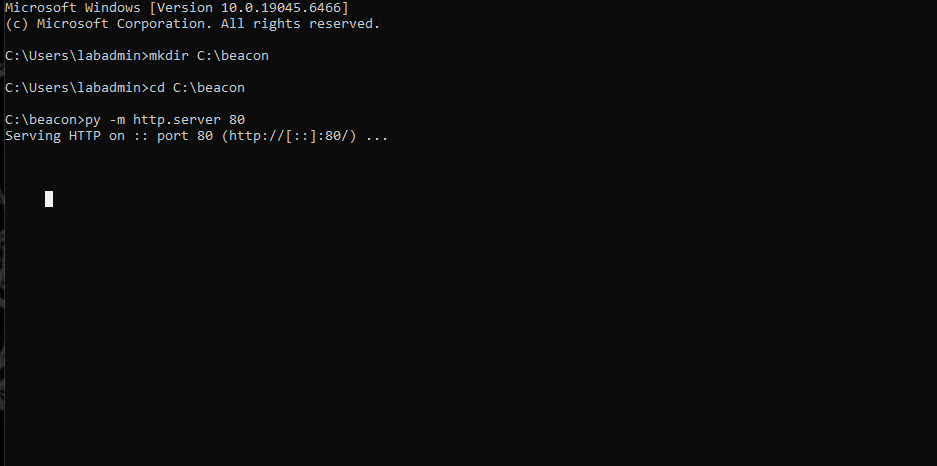
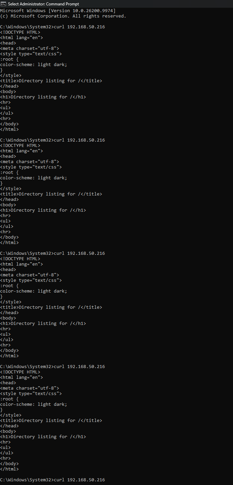
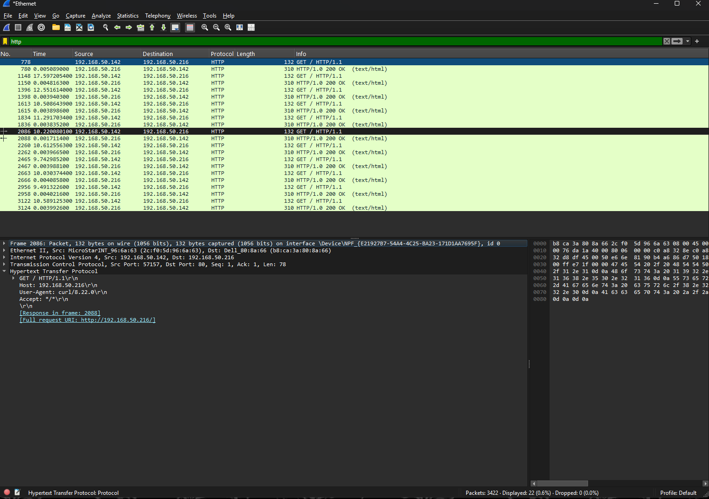

# Lab 4: Beaconing Detection
 
## Goal
Catch fake malware "checking in" with an attacker's server on a regular schedule.
 
Infected computers often contact their C2 (Command and Control) server at regular times. This is called **beaconing**.

**MITRE ATT&CK:** T1071.001 – Application Layer Protocol: Web Protocols
 
---

## My Setup
 
| Role | IP |
|---|---|
| Computer A ("infected" computer + Wireshark) | 192.168.50.142 |
| Computer B (fake C2 server) | 192.168.50.216 |
 
---
 
## What I Did
I turned on a simple web server on Computer B to act as the C2 server. Then I started a Wireshark capture on Computer A and ran `curl` about every 10 seconds to act like malware checking in. After that, I stopped the capture and looked at the timing.

---
 
## 1. Start the Fake C2 Server (Computer B)
```
mkdir C:\beacon
cd C:\beacon
py -m http.server 80
```
These make an empty folder, go into it, and turn on a simple web server on port 80 (HTTP).
 

 
---

## 2. Fake Malware Check-Ins (Computer A)
```
curl 192.168.50.216
```
I ran this about every 10 seconds. Each time, it asks Computer B's web server for a page, like malware checking in or like a beacon
 

 
---

## 3. Regular Timing
```
http
```
This shows only HTTP (HyperText Transfer Protocol) traffic.
 
To see the time between check-ins, I changed: **View → Time Display Format → Seconds Since Previous Displayed Packet**.
 
I found **11** `GET /` requests from 192.168.50.142 to 192.168.50.216. After the first one, they came about **every 10 seconds** (between 9.5 and 12.5 seconds), and the server answered each one with `200 OK`.
 

 
---

## 4. Not a Real Browser
Every request had the User-Agent **`curl/8.22.0`**. A real web browser says "Mozilla...", so this traffic came from a **program, not a person**.
 


---
 
## Signs of Beaconing
- The same computer contacting the same server over and over
- Check-ins at regular times (about every 10 seconds)
- A User-Agent that isn't a browser (`curl`)
- Small requests and responses that are about the same size each time
  
> **Note:** Real malware often adds random timing, called **jitter**, to look less obvious. The small differences in my lab (9.5–12.5 seconds) show why analysts look for *mostly* regular patterns, not perfect ones.
 
---
